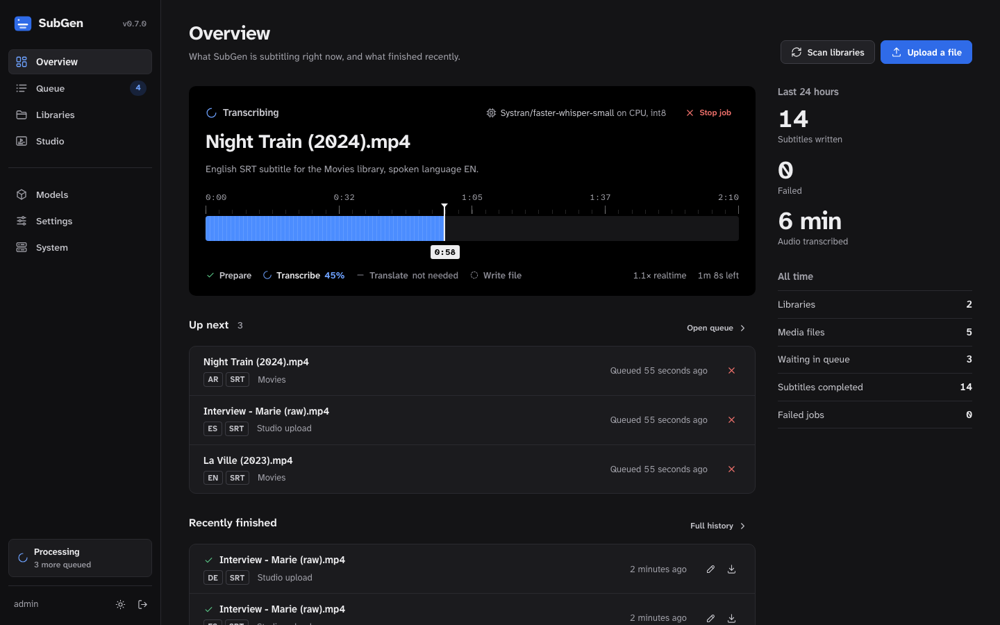
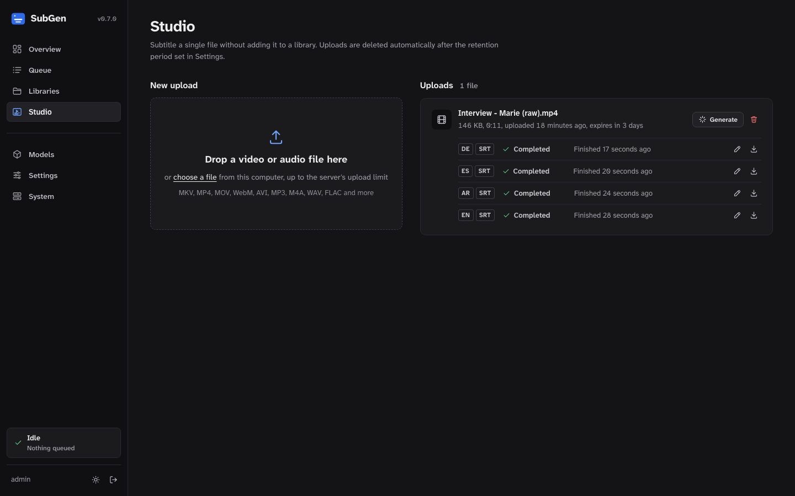
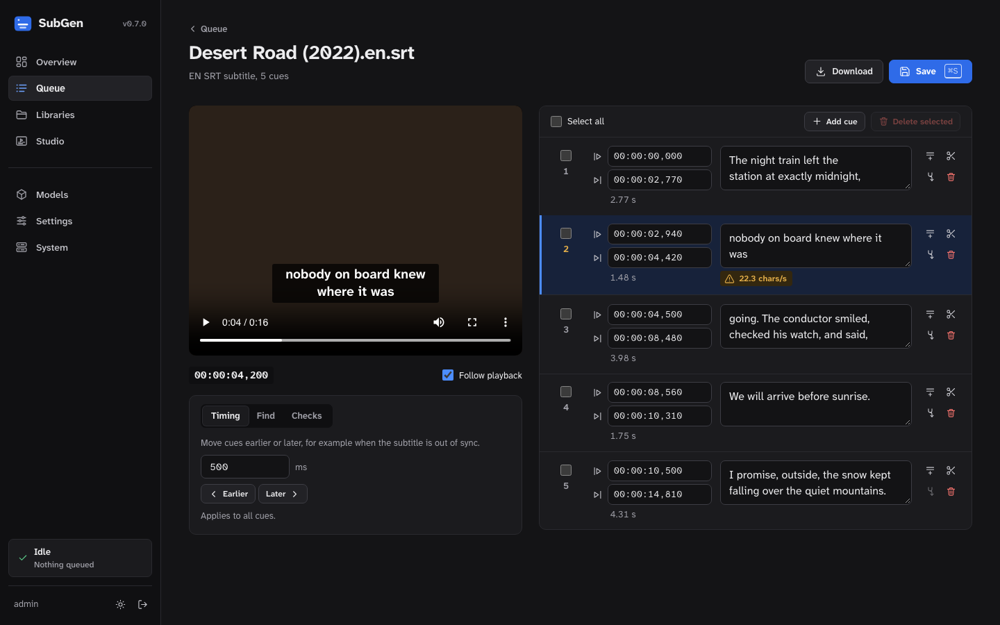
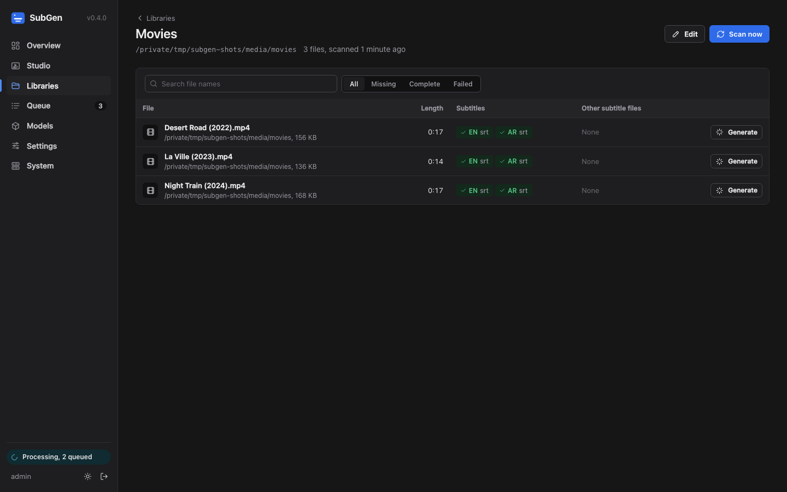
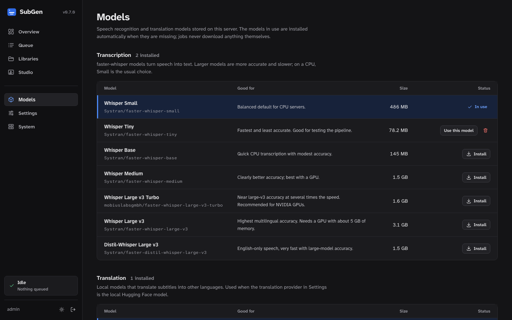

<div align="center">

<h1>SubGen</h1>

<p><strong>Private, local subtitle generation for self-hosted media libraries</strong></p>

<p>
  <a href="https://github.com/Fahed-Alhammadi/SubGen/actions/workflows/ci.yaml"></a>
  <a href="https://github.com/Fahed-Alhammadi/SubGen/actions/workflows/container.yaml"></a>
  <a href="https://github.com/Fahed-Alhammadi/SubGen/pkgs/container/subgen"></a>
  <a href="LICENSE"></a>
</p>

<p><a href="https://fahed-alhammadi.github.io/SubGen/">Website</a> · <a href="#quick-start">Quick start</a> · <a href="docs/API.md">API reference</a></p>

</div>

SubGen watches your media libraries, transcribes speech with
[faster-whisper](https://github.com/SYSTRAN/faster-whisper), translates it with local models, and
writes readable subtitle sidecars (`Movie (2024).ar.srt`) beside each file. Everything runs on your own
server. One container image works on CPU and NVIDIA GPUs.



> **Status:** active pre-1.0 development. Pin a versioned image, keep backups, and check results on a
> few representative files before processing an irreplaceable library unattended.

## Features

**Subtitle quality**
- Word-timestamp re-segmentation: every cue respects max characters per line, max lines, and minimum
  and maximum on-screen time. Breaks prefer sentence ends, clauses and pauses.
- Balanced two-line wrapping with CJK/Thai awareness, minimum gaps, no overlaps, and a short linger
  after speech.
- Hallucination filtering removes "Thanks for watching", subtitle credits and repetition loops
  invented by Whisper during silence or music.
- Translation runs on sentence-sized units and is redistributed across the original cue timings, so
  translated subtitles stay in sync.

**Fast and local**
- Transcribe once, translate many: transcripts are cached, so extra languages and formats skip
  Whisper entirely. Formats of the same language are written together.
- Batched GPU inference (3–6× faster on NVIDIA). CPU int8 inference on any x86-64 server.
- Local translation with NLLB-200, M2M100 or Marian/OPUS-MT models, or self-hosted Ollama /
  LibreTranslate. Nothing is sent to a cloud service.

**Libraries**
- Unlimited libraries, each with its own target languages and SRT / ASS / WebVTT formats.
- Skips languages that already have subtitles: external sidecars in any common naming
  (`Movie.eng.srt`, `Movie.English.sdh.srt`) and, optionally, embedded tracks.
- Picks the right audio track in multi-audio files by language preference and passes its language
  tag to Whisper.
- Ignore patterns (`sample, trailer`), protection for files still being copied, safe pruning of
  deleted media that never wipes an unmounted share.

**Tools**
- **Studio:** drag and drop any video or audio file and download subtitles. No library needed.
- **Subtitle editor:** video preview with live captions, timecode editing, split/merge, timing shift,
  find & replace, and readability warnings (reading speed, line length, overlaps).
- **Model vault:** default models installed on first start, one-click recommended models, Hugging Face
  search, download progress, and an offer to delete the old model when you switch.
- **Queue:** filters, search, priorities, bulk cancel/retry/clear, per-file generation with
  audio-track and language overrides.
- Settings editor generated from the backend's settings schema, provider connection tests, an audit
  log, and database backup and restore.

**Security**
- Single administrator with Argon2 password hashing, optional two-factor sign-in (TOTP, turned on from
  **Settings → Security**), login throttling, and session revocation.
- CSRF tokens on every mutation, a strict Content-Security-Policy (no inline scripts or styles), and
  path confinement for every file operation.
- Runs as a non-root UID/GID with all capabilities dropped and `no-new-privileges`.

## Screenshots

| Studio | Subtitle editor |
| --- | --- |
|  |  |
| **Library browser** | **Models** |
|  |  |

## How it works

```text
media file ─► ffprobe ─► choose audio track ─► ffmpeg (16 kHz mono)
           ─► faster-whisper (word timestamps, VAD) ──► transcript cache
           ─► clean hallucinations ─► re-segment into readable cues
           ─► translate sentence units (if target ≠ spoken language)
           ─► balance lines, fix timing ─► atomic write: Movie.ar.srt / .ass / .vtt
```

```text
Browser ──HTTPS──► reverse proxy ──► SubGen container
                                      ├─ Web UI + JSON API (FastAPI)
                                      ├─ Scheduler (library scans, upload expiry)
                                      ├─ Worker (one job at a time, models kept loaded)
                                      └─ SQLite (jobs, settings, transcripts, audit)
                                             │
                          /media (libraries)  /models  /config
```

## Requirements

- Linux with Docker Engine and Docker Compose v2 (`linux/amd64` image)
- Write permission for every media library (subtitles are stored beside the media)
- Disk space for models: about 0.5 GB (Whisper Small) to 3 GB (Large v3), plus 2.5 GB for NLLB-200
- For GPU processing: an NVIDIA GPU, a current driver, and the NVIDIA Container Toolkit

## Quick start

```bash
git clone https://github.com/Fahed-Alhammadi/SubGen.git
cd SubGen
cp .env.example .env
mkdir -p data/config data/models media
chown -R 1000:1000 data media
```

Set the required credentials in `.env`:

```env
SUBGEN_ADMIN_USERNAME=admin
SUBGEN_ADMIN_PASSWORD=replace-with-a-long-unique-password
SUBGEN_SECRET_KEY=replace-with-at-least-32-random-characters
```

Generate a signing key with `openssl rand -hex 32`, then start SubGen:

```bash
docker compose up -d
```

Open `http://127.0.0.1:8080` and sign in. When testing over plain HTTP on a LAN, set
`SUBGEN_SECURE_COOKIES=false`; keep it `true` behind HTTPS.

### First run

1. **Models:** Whisper Small and NLLB-200 600M install automatically on first start (about 3 GB; jobs
   wait until they finish). On a GPU, switch to Large v3 Turbo; SubGen then offers to delete the old
   model or keep it.
2. **Studio:** drop a short clip to check quality before touching your library.
3. **Libraries:** add each mounted folder (the folder picker browses `/media`), choose target
   languages and formats, and select **Scan**.
4. **Queue / Overview:** follow progress, speed and ETA. Use **Edit** on any finished subtitle.

## Models

The **Models** page lists recommended models with one-click install:

| Model | Kind | Size | Notes |
| --- | --- | --- | --- |
| `Systran/faster-whisper-small` | Whisper | 0.5 GB | Balanced CPU default |
| `mobiuslabsgmbh/faster-whisper-large-v3-turbo` | Whisper | 1.6 GB | Recommended on NVIDIA GPUs |
| `Systran/faster-whisper-large-v3` | Whisper | 3.1 GB | Best multilingual accuracy |
| `facebook/nllb-200-distilled-600M` | Translation | 2.5 GB | 200 languages, default |
| `facebook/m2m100_418M` | Translation | 1.9 GB | Lighter, 100 languages |
| `Helsinki-NLP/opus-mt-*` | Translation | 0.3 GB | Fast single-pair models |

Any CTranslate2 Whisper repository or Transformers seq2seq translation repository on Hugging Face can
be installed from the search box. Downloads skip unused framework weights (TensorFlow, Flax, ONNX) and
are stored under `SUBGEN_MODEL_PATH`:

```text
data/models/
├── whisper/Systran/faster-whisper-small/
└── translation/facebook/nllb-200-distilled-600M/
```

The models in use are installed automatically when they are missing (on first start, Whisper Small and
NLLB-200 600M); the queue waits while they download. Any model that is not in use, including the
defaults, can be deleted. Set `SUBGEN_AUTO_INSTALL_MODELS=false` on servers without internet access and
copy models into the folders above instead.

## Settings

Pipeline settings are edited in the web UI and stored in the database. Defaults:

| Group | Setting | Default |
| --- | --- | --- |
| Transcription | Spoken language | Detect automatically |
| | Preferred audio tracks | Default track |
| | Beam size / batch size | 5 / auto (8 on GPU) |
| | Skip silence (VAD), filter hallucinations | On |
| | Vocabulary prompt | Empty |
| Segmentation | Characters per line / lines | 42 / 2 (≈19 for CJK) |
| | Subtitle duration | 1.0 – 6.0 s, 80 ms gap, 250 ms linger |
| Translation | Provider | Local Hugging Face model |
| Scanning | Interval | 30 min |
| | Skip existing / embedded subtitles | On / Off |
| | Ignore files containing | `sample, trailer, featurette` |
| Output | ASS font, UTF-8 BOM for SRT | Arial 56 / Off |
| Workspace | Keep Studio uploads | 72 h |

Individual jobs can override the spoken language, audio track and vocabulary prompt.

## Translation providers

- **Local Hugging Face:** NLLB-200, M2M100, and Marian/OPUS-MT models from `/models`. Uses the GPU
  when available.
- **Ollama:** any local LLM through `/api/chat` with validated JSON output and automatic batch
  splitting.
- **LibreTranslate:** a private LibreTranslate server, with batched requests.

When Ollama or LibreTranslate runs in another container, attach both to the same Docker network and
use the service name in the URL. When it runs directly on the host, use an address reachable from the
container, not `127.0.0.1`.

## CPU and NVIDIA GPU

The provided `docker-compose.yaml` requests every NVIDIA GPU (`gpus: all`). With
`SUBGEN_WHISPER_DEVICE=auto`, SubGen uses CUDA when a GPU is visible and CPU otherwise. On CPU-only
hosts, remove `gpus: all`.

## Multiple media libraries

Mount each library below `/media`:

```yaml
services:
  subgen:
    volumes:
      - /srv/movies:/media/movies
      - /mnt/nas/television:/media/tv
      - /mnt/archive/anime:/media/anime
```

All mounts must be writable. NFS and SMB shares can be mounted by the host or declared as Compose
volumes. Keep share credentials out of Git.

## Subtitle naming

```text
Movie Name (2026).mkv
Movie Name (2026).ar.srt
Movie Name (2026).en.vtt
Movie Name (2026).fr.ass
```

## Configuration

See [.env.example](.env.example) for the full template.

| Variable | Purpose |
| --- | --- |
| `PUID`, `PGID` | Host filesystem identity |
| `SUBGEN_ADMIN_USERNAME`, `SUBGEN_ADMIN_PASSWORD` | Administrator login (password ≥ 12 characters) |
| `SUBGEN_SECRET_KEY` | Session-signing key (≥ 32 characters) |
| `SUBGEN_TOTP_SECRET` | Optional: enforce two-factor sign-in with this Base32 secret instead of enabling it in Settings |
| `SUBGEN_MEDIA_PATH`, `SUBGEN_MODEL_PATH`, `SUBGEN_CONFIG_PATH` | Host directories |
| `SUBGEN_WHISPER_DEVICE` | `auto`, `cpu` or `cuda` |
| `SUBGEN_WHISPER_COMPUTE_TYPE` | `auto` (float16 on GPU, int8 on CPU) or any CTranslate2 type |
| `SUBGEN_AUTO_INSTALL_MODELS` | Install the selected models when missing (default `true`; set `false` offline) |
| `SUBGEN_MAX_UPLOAD_MB` | Studio upload limit (default 20480) |
| `SUBGEN_WORKSPACE_DIR` | Studio upload storage (default `/config/workspace`) |
| `SUBGEN_STABLE_FILE_SECONDS` | Wait before processing recently modified files |
| `SUBGEN_BIND_ADDRESS`, `SUBGEN_PORT` | Published address and port |
| `SUBGEN_SECURE_COOKIES` | HTTPS-only cookies (keep enabled behind HTTPS) |
| `SUBGEN_SESSION_HOURS` | Session lifetime |
| `SUBGEN_LOGIN_ATTEMPTS`, `SUBGEN_LOGIN_WINDOW_SECONDS` | Login throttling |
| `SUBGEN_TRUSTED_PROXIES` | Proxies allowed to supply `X-Forwarded-For` |

Reverse proxies must allow large request bodies for Studio uploads (for example
`client_max_body_size 20g;` in nginx).

## Security

- Replace all credentials before the first launch and use HTTPS for remote access.
- Mutating API requests require a session-bound CSRF token. Logout revokes all sessions.
- Every file operation is confined to its library, the media root, or the Studio workspace.
- The container runs as `PUID`/`PGID`, drops all Linux capabilities, enables `no-new-privileges`, and
  never mounts the Docker socket.
- Keep `.env`, media, models and databases out of Git.

## Backup and restore

**System → Backup** downloads a consistent SQLite snapshot (settings, libraries, jobs, transcripts,
audit log). A restore is validated, staged in `/config`, and applied on restart. Backups do not
include media, subtitles or models.

## Updating

```bash
docker compose pull
docker compose up -d
```

Database migrations run automatically on start. Pin a version (`ghcr.io/fahed-alhammadi/subgen:0.4`)
for reproducible deployments.

## Project structure

```text
subgen/
├── main.py            App assembly, security headers, background loops
├── api/               HTTP routers (auth, jobs, libraries, media, models, settings, subtitles, system)
├── pipeline.py        Probe → audio → Whisper (cached) → segment → translate
├── segmentation.py    Subtitle-quality engine (re-segmentation, wrapping, hallucination filter)
├── worker.py          Job queue worker
├── media.py           Library scanning, Studio workspace
├── providers.py       Translation providers (Hugging Face, Ollama, LibreTranslate)
├── models.py          Model vault
├── settings_store.py  Settings schema and validation
├── languages.py       Language codes, names, NLLB/Whisper mappings
├── audio.py           ffprobe / ffmpeg
├── subtitles.py       Sidecar reading, writing and detection
├── db.py              SQLAlchemy models and migrations
└── static/            Web UI (no build step, native ES modules)
docs/API.md            HTTP API reference
Website/               Project website (GitHub Pages)
```

## Development

```bash
uv venv --python 3.12 .venv
uv pip install --python .venv/bin/python -e ".[dev]"
export SUBGEN_ADMIN_PASSWORD=dev-password-123 SUBGEN_SECRET_KEY=$(openssl rand -hex 32) \
       SUBGEN_SECURE_COOKIES=false SUBGEN_CONFIG_DIR=./data/config SUBGEN_MODEL_DIR=./data/models \
       SUBGEN_MEDIA_ROOT=./media
.venv/bin/uvicorn subgen.main:app --reload --port 8080
.venv/bin/ruff check .
```

`ffmpeg` and `ffprobe` must be on `PATH`. The frontend has no build step: edit `subgen/static/` and
reload.

## Contributing

Issues and pull requests are welcome. Keep changes focused, run `ruff check .`, describe how you
tested, and never include credentials, media or model files.

## License

SubGen is licensed under the [Elastic License 2.0](LICENSE) (`Elastic-2.0`). You may use, copy,
modify and redistribute the software subject to its terms. You may not offer SubGen to third parties as
a hosted or managed service that exposes a substantial set of its functionality, and you must preserve
its license and copyright notices.

---

© 2026 Fahed Alhammadi. All rights reserved.
